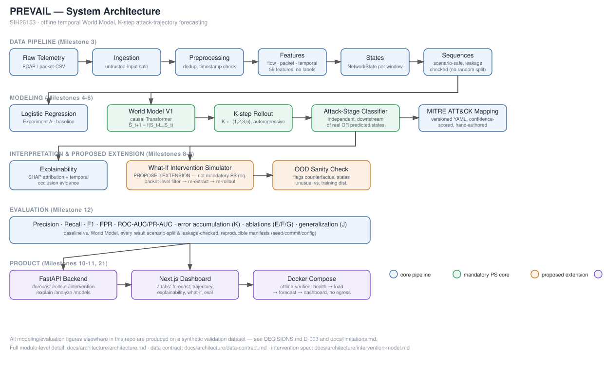

# PREVAIL — System Architecture



Status: DRAFT v0.1

## 1. Design principles

1. Research/notebooks stay separate from production code (`notebooks/` vs `src/prevail/`).
2. Every stage of the pipeline is a pure, testable function/module — no hidden global state.
3. Ground-truth labels (`attack_label`, `attack_stage`) never enter the predictive feature path (enforced by property test, see data-contract.md §2).
4. The World Model's primary output is a *future state*, not a same-instant label — this is the structural distinction from a classifier, enforced by module boundaries below (world_model/ only ever emits `NetworkState`-shaped tensors; attack_stage/ is a strictly downstream interpretation layer over those states).
5. Everything must run fully offline after `docker-compose build`.

## 2. Repository layout

See master prompt §7 for the canonical tree; implemented under this repo root directly (no extra `prevail/` nesting) at:

```text
sih/
├── docs/            # research, requirements, architecture, experiments, demo
├── configs/         # datasets, features, models, experiments (all YAML, versioned)
├── data/            # raw (untracked) / interim / processed / metadata
├── src/prevail/     # production package, see module map below
├── tests/           # unit / integration / property / regression
├── frontend/        # Next.js + TypeScript dashboard
├── scripts/         # one-off / operational scripts
├── notebooks/        # exploratory only, never imported by src/
└── artifacts/        # trained models, reports, experiment outputs (mostly untracked)
```

## 3. Module map (`src/prevail/`)

| Module | Responsibility | Depends on | Must NOT do |
|---|---|---|---|
| `ingestion/` | Load raw telemetry (PCAP via pyshark/scapy-free CSV path preferred; flow-CSV ingestion) into a raw, untrusted-safe intermediate form | — | Never execute/parse uploaded files as code; enforce size/type limits |
| `preprocessing/` | Cleaning, timestamp normalization, dedup, per-scenario partitioning | ingestion | Silently drop rows without logging (data-quality report) |
| `features/` | Flow/packet/temporal feature extraction per data-contract.md | preprocessing | Read `attack_label`/`attack_stage` |
| `states/` | Assemble `NetworkState` objects from features + windows | features | — |
| `sequences/` | Build chronological, scenario-safe state sequences; leakage checks | states | Cross scenario boundaries in one sequence |
| `baselines/` | Logistic Regression baseline (FR-07) | features (current-state input only) | — |
| `world_model/` | Temporal Transformer encoder, next-state prediction head (FR-08, FR-09) | sequences | Take ground-truth future state as input at inference time |
| `rollout/` | K-step autoregressive rollout (FR-10) | world_model | Silently clip/hide error accumulation — must report it |
| `attack_stage/` | Map (real or predicted) states → normalized attack-stage + probability (FR-11, FR-12) | states/world_model output | Treat a predicted state as ground truth without provenance tag |
| `attack_mapping/` | Normalized stage → MITRE ATT&CK tactic/technique, versioned + confidence-scored (FR-13) | attack_stage | Auto-generate mappings from an unconstrained LLM without validation |
| `explainability/` | SHAP feature attribution + temporal window attribution (FR-14) | world_model, baselines | Present attribution as causal |
| `intervention/` | Defensive what-if state transforms + counterfactual rollout (FR-17, proposed extension) | rollout, states | Claim real-world causal prevention |
| `evaluation/` | Precision/Recall/F1/FPR/ROC-AUC/PR-AUC, baseline vs World Model, ablations (FR-15) | all above | Report metrics without config/seed/commit provenance |
| `api/` | FastAPI endpoints (Phase 22) | all above | Expose filesystem, execute uploads |
| `common/` | Shared types (`NetworkState` pydantic model), config loading, seeding, experiment manifest | — | — |

## 4. Data flow (implementation order — matches milestone order)

```text
raw telemetry (PCAP / flow CSV)
      -> ingestion
      -> preprocessing (dedup, timestamp integrity)
      -> features (flow/packet/temporal, NO labels)
      -> states (NetworkState, window_size experimental)
      -> sequences (scenario-safe, leakage-checked)
      -> [baselines: Logistic Regression on current-state features]
      -> world_model (temporal Transformer, one-step S_t -> Ŝ_{t+1})
      -> rollout (K-step autoregressive)
      -> attack_stage (states -> stage probabilities)
      -> attack_mapping (stage -> ATT&CK, versioned/confidence-scored)
      -> explainability (SHAP + temporal evidence, attached to any prediction)
      -> intervention (optional: modify state, re-rollout, compare)
      -> evaluation (baseline vs world model, ablations, generalization splits)
```

## 5. World Model V1 (Phase 10)

```text
Historical states (batch, seq_len, feature_count)
      -> feature projection (linear)
      -> positional encoding
      -> Transformer encoder (2-4 layers, 2-4 heads, small embed dim, dropout)
      -> next-state prediction head(s):
           continuous features -> regression head (MSE/Huber)
           binary features     -> BCE head
           categorical dists    -> cross-entropy head
      -> combined loss (weighted sum, documented per experiment)
```

Starting hyperparameters (master prompt §13) are experimental defaults, not fixed — see `docs/experiments/world-model.md` for tuning results once run.

## 6. Offline operation (Phase 21)

- Backend + model + frontend packaged via `docker-compose.yml`; no outbound calls at inference time.
- Offline smoke test (network namespace / firewall disabled): start stack -> load sample telemetry -> forecast -> dashboard renders. Implemented as `scripts/offline_smoke_test.sh` + `tests/integration/test_offline.py`.

## 7. API surface (Phase 22)

```text
POST /api/v1/datasets/upload         # validated, size-limited, isolated parsing
POST /api/v1/analyze                 # ingest -> state for an uploaded capture
POST /api/v1/forecast                # one-step / K-step forecast for a given state/sequence
POST /api/v1/rollout                 # explicit K-step rollout endpoint
POST /api/v1/intervention/simulate   # what-if counterfactual rollout
GET  /api/v1/models                  # registered model versions
GET  /api/v1/experiments/{id}        # experiment manifest + metrics
GET  /api/v1/health                  # liveness/readiness
```

## 8. See also

- `docs/architecture/data-contract.md` — NetworkState schema, feature registry, windowing.
- `docs/architecture/threat-model.md` — security posture of PREVAIL itself.
- `docs/architecture/intervention-model.md` — per-intervention transformation spec (written at Milestone 9).
