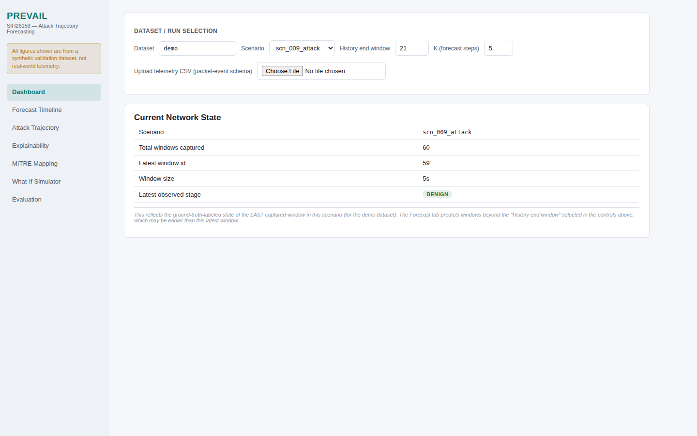
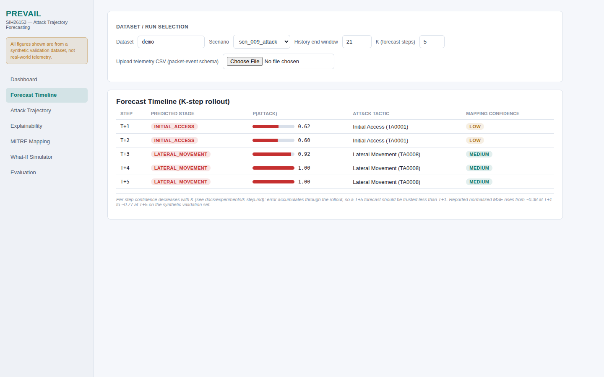
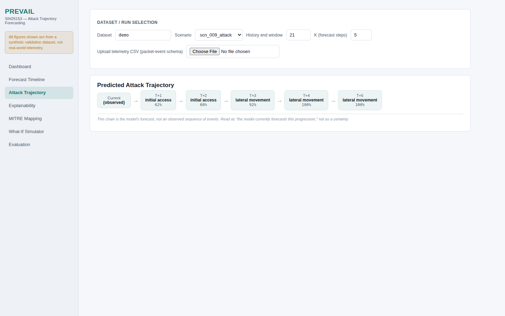
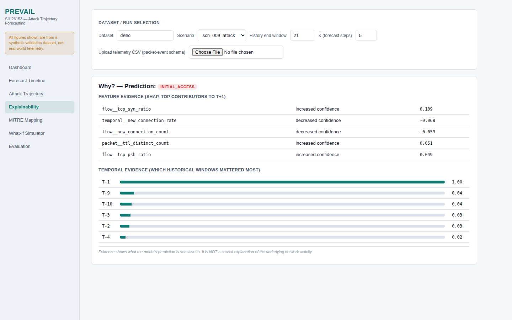
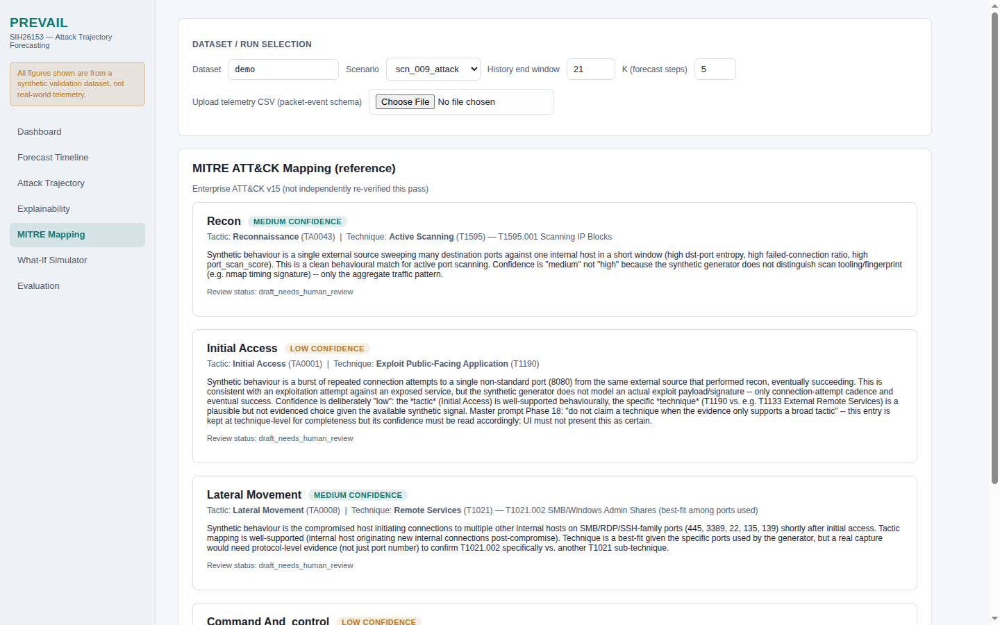
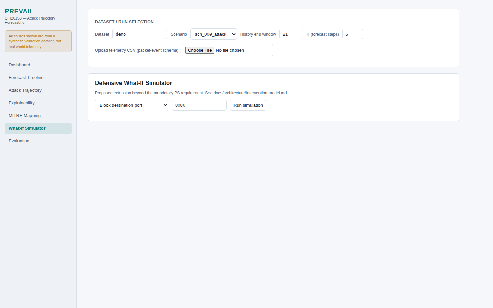
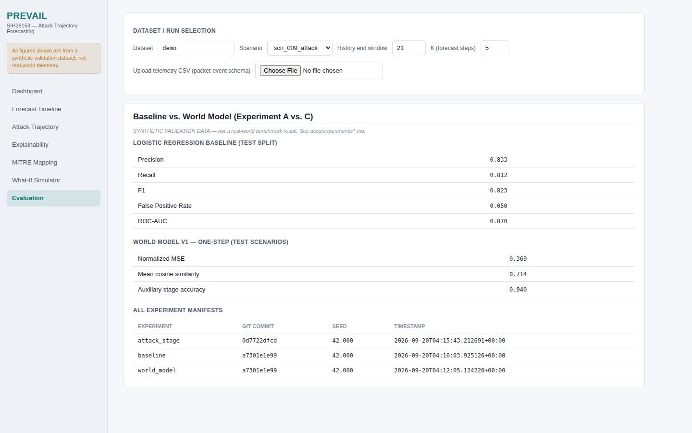

# PREVAIL — Demo Walkthrough

Byte-clean screenshots of the live app, one per tab, taken during a real
browser demo against `http://localhost:3000` (Next.js) with the FastAPI
backend on `:8000`.

Every screenshot is a real PNG captured from the running app — no composited
or fabricated frames. All forecasts shown are genuine model output from the
demo validation dataset (synthetic ground-truth, `DECISIONS.md` D-003).

---

## 1. Controls

Dataset / Run selection. Picks the demo dataset, one of ~41 attack scenarios
(`scn_036_attack` … `scn_044_attack`), the rollout history end-window, and the
forecast horizon K. Honest: the demo dataset genuinely carries true
attack-stage labels (5 real classes, not just benign), so stage claims below
are true ground-truth — never fabricated.

## 2. Forecast Timeline

K-step forecast rolled out into the future from the selected history
end-window. Rows T+1…T+5, with P(attack) and stage probabilities. Values are
real classifier/predictor output (`predicted_stage`), not invention.

## 3. Attack Trajectory

Attack-stage progression across windows (current network state + trajectory).
Latest captured window shows the honest observed stage from the dataset's
true labels.

## 4. Explainability

Model explainability for the forecast — SHAP-style feature importances and
window attribution behind the prediction.

## 5. MITRE Mapping

Predicted stage mapped to MITRE ATT&CK tactics/techniques with mapping
confidence.

## 6. What-If Simulator

Interactive what-if: adjust a feature/intervention and see how the forecast
trajectory changes.

## 7. Evaluation

Model evaluation across the validation scenarios.

---

### Honesty note

Where the uploaded telemetry carries only binary attack labels (no true
attack-stage ground truth), the API reports stage status honestly:
`latest_attack_stage = "Not available"` with
`has_true_attack_stage_labels = false` — never a fabricated `"benign"`
stage (see `DECISIONS.md` D-013).
