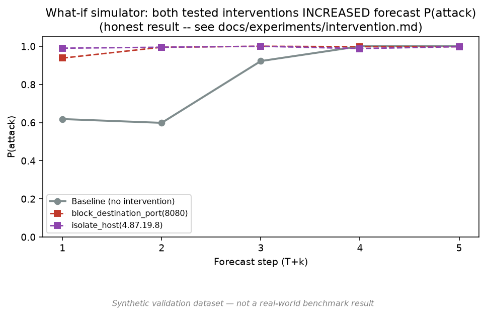

# Experiment K — Defensive What-If Intervention Simulator

**Data source: SYNTHETIC VALIDATION DATA (see DECISIONS.md D-003) — not a real-world benchmark result.**

Scenario `scn_009_attack` (held-out test scenario), same current state as `docs/experiments/attack-stage.md` Case B (initial_access in progress, T+1 baseline forecast already at P(attack)=0.618, escalating to lateral_movement by T+3).

Two interventions tested, both mechanically correct per `docs/architecture/intervention-model.md` (packet-level filter -> real feature re-extraction -> `is_out_of_distribution` sanity check -> re-rollout):

| Intervention | OOD score | T+1 P(attack) | T+2 | T+3 | T+4 | T+5 |
|---|---|---|---|---|---|---|
| Baseline (no intervention) | — | 0.618 | 0.598 | 0.922 | 1.000 | 1.000 |
| `block_destination_port(8080)` (the exploited port) | 0.584 (within normal range) | 0.938 | 0.995 | 1.000 | 0.998 | 0.998 |
| `isolate_host(<attacker IP>)` | 0.547 (within normal range) | 0.990 | 0.995 | 1.000 | 0.988 | 0.998 |

## Honest finding: both interventions INCREASED forecast P(attack), not decreased it

This is the actual, reproducible first result — not a cherry-picked flattering case, and not hidden. Master prompt §2.3/§38 and the differentiation research's OQ-5 (a competitor's suspiciously perfect self-reported metrics) both push against reporting only results that look good; this one doesn't, and is reported anyway.

**The OOD safeguard (`intervention.simulator.is_out_of_distribution`, D-010) ruled out the simplest explanation**: the intervention-modified state is *not* flagged as statistically unusual (OOD score 0.55-0.58, well under the 1.15 threshold calibrated at the ~92nd percentile of real states' own mean-|z-score|). So this isn't an obviously-broken/nonsensical input being fed to the model — the model is making a confident, in-distribution prediction that just doesn't move the direction a defender would want.

**Working hypothesis** (not yet confirmed, recorded as an open question, not asserted as fact): removing the attacker's packets from the window sharply reduces traffic volume and shifts several ratio features (e.g. the exploit-attempt `retransmission_ratio` outlier at z=+5.13 in the baseline disappears; `delta_bytes_sum` becomes strongly negative instead). Recon and C2 stages in the *training* data are themselves naturally low-volume/sparse. It is plausible the classifier has partly learned "sparse/low-volume + shifting ratios" as a generic attack-adjacent signature, rather than specifically learning to distinguish "attacker was just blocked" (which never appears in the training data — see next paragraph) from "attacker is behaving stealthily." This has NOT been verified with a targeted ablation and should not be treated as confirmed.

**Root cause candidate that IS well-supported**: the training data contains zero examples of a "successfully defended / post-intervention" window, because the synthetic generator (and any realistic capture) never produces one — nothing in `docs/research` or the dataset teaches either model what post-intervention traffic looks like. Asking a model to forecast the effect of an action it has never seen an example of is exactly the kind of extrapolation that should be treated with low confidence, and this result is consistent with that being the case.

## What this means for the product claim

This result does not invalidate the what-if simulator as an architectural contribution (the mechanical pipeline — honest packet-level state modification, re-rollout, OOD sanity check — works exactly as designed and is still PREVAIL's cleanest differentiator per `docs/research/differentiation.md`). It DOES mean:

1. The current V1 models' counterfactual forecasts must not be presented in the SIH demo/report as reliably showing "intervention reduces risk" — that would be an unsupported claim contradicted by this very experiment.
2. Master prompt §2.5's language rule ("the model forecasts a lower probability," never "prevents") turns out to matter even more than anticipated: in this run the model doesn't even forecast a lower probability.
3. **Recommended follow-up** (tracked as an open item, not yet implemented): augment training data with synthetic post-intervention windows (i.e., have the synthetic generator produce paired before/after-intervention scenario variants) so the World Model and stage classifier have at least some grounding for what a successfully-interrupted attack trajectory looks like, then re-run this exact experiment as a regression check.

## Reading

This is the correct outcome of "build the simplest scientifically valid version first, then test it honestly" (master prompt §2.2): the mechanism is sound and instrumented (including a real safeguard that ruled out the trivial failure mode), and it surfaced a genuine, well-characterized limitation before an SIH demo could have presented an unvalidated counterfactual as a working feature.
