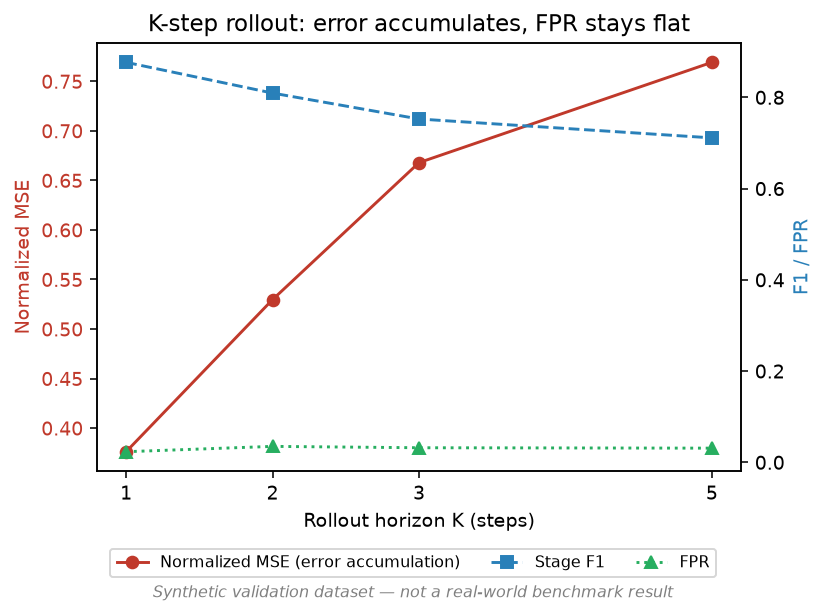

# Experiment D — K-step Rollout Evaluation

**Data source: SYNTHETIC VALIDATION DATA (see DECISIONS.md D-003) — not a real-world benchmark result.**

460 rollout trajectories built from the 10 held-out test scenarios (every valid start position with >=5 future in-scenario windows). Same World Model V1 checkpoint as `docs/experiments/world-model.md`, rolled out autoregressively per `rollout/rollout.py` (sliding-window history, no ground truth fed back in after step 1).

## Error accumulation across K = 1, 2, 3, 5

| Step | Normalized MSE | Cosine similarity | Stage accuracy | F1 | FPR | Mean P(attack) |
|---|---|---|---|---|---|---|
| t+1 | 0.376 | 0.696 | 0.939 | 0.877 | 0.023 | 0.236 |
| t+2 | 0.530 | 0.769 | 0.896 | 0.809 | 0.035 | 0.221 |
| t+3 | 0.668 | 0.787 | 0.863 | 0.752 | 0.032 | 0.201 |
| t+4 | 0.758 | 0.826 | 0.848 | 0.725 | 0.034 | 0.189 |
| t+5 | 0.769 | 0.861 | 0.852 | 0.711 | 0.031 | 0.175 |

(Note: cosine similarity *rising* with K while MSE also rises is not a contradiction — cosine similarity is scale-invariant and the predicted vectors' *direction* stabilizes as rollout regresses toward the feature-space mean, even as magnitude error grows. Read MSE as the primary error-accumulation signal.)

## Reading

- **Error accumulates as expected, and degrades gracefully, not catastrophically**: normalized MSE roughly doubles from t+1 to t+5 (0.376 -> 0.769) and plateaus rather than diverging — the model isn't blowing up, but confidence in the forecast should genuinely decrease with K. Stage classification F1 drops from 0.877 at t+1 to 0.711 at t+5.
- **FPR stays flat (~0.02-0.035) across all K** — degraded rollout loses *recall* (misses attacks it would have caught at t+1) rather than hallucinating new false alarms. This is the failure mode you want from a forecasting system used defensively.
- **Do not assume K=5 is "the" answer** (master prompt explicit warning): t+1 is meaningfully more trustworthy than t+5. The API/frontend must surface per-step confidence, not present a flat K=5 trajectory as uniformly reliable.
- No K value was cherry-picked after the fact — all four required values (1, 2, 3, 5) are reported per master prompt Phase 16, not just the best-looking one.

## Limitations

- Single hyperparameter configuration (no window-size or seq-length ablation yet — Experiments H/I, not yet run).
- 460 trajectories from only 10 scenarios; per-step metrics have real sampling noise given the modest scenario count.
